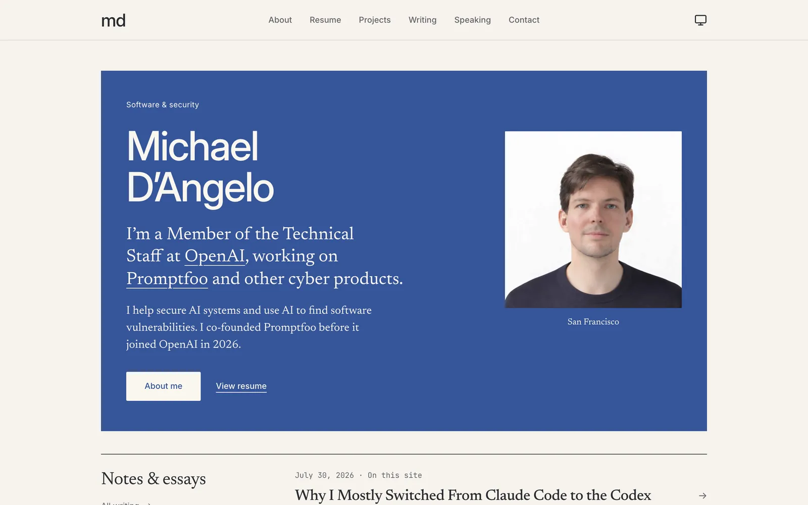

# Michael D'Angelo: Personal Site

[](https://github.com/mldangelo/personal-site/actions/workflows/node.js.yml)
[](./LICENSE)

The source for [mldangelo.com](https://mldangelo.com): a portfolio, résumé, and
blog built with [Next.js](https://nextjs.org/), [React](https://react.dev/),
[TypeScript](https://www.typescriptlang.org/), and
[Tailwind CSS](https://tailwindcss.com/), published as static files on GitHub
Pages.

You're welcome to fork it for your own site or borrow any part of it.

<picture>
  <source media="(prefers-color-scheme: dark)" srcset="./docs/images/home-dark.webp">
  
</picture>

[Live site](https://mldangelo.com) · [Get started](#get-started) ·
[Customize](#customize) · [Deploy](#deploy)

## Features

- **Content in plain files.** Posts are Markdown, and the résumé, projects, and
  talks are typed data. There is no database or CMS to run.
- **Static hosting.** The site builds to plain HTML for GitHub Pages, on a
  custom domain or at `your-name.github.io/your-repo/`, chosen by one line in
  `package.json`.
- **Writing.** Drafts stay out of the published site, and every post gets RSS,
  sitemap, and `llms.txt` entries and a generated share card.
- **A résumé** that prints cleanly and is also published as
  [JSON Resume](https://jsonresume.org/).
- **Readable anywhere.** Light and dark themes follow the device, and layouts
  hold up on a 320px phone, at 200% text size, and in high-contrast mode.
- **Checked before it ships.** CI builds the site and checks every page, image,
  and internal link, so a broken link or a leaked draft fails the build instead
  of going live.
- **No tracking by default.** Analytics loads only if you add a Google
  Analytics ID.

## Get started

You'll need [Git](https://git-scm.com/) and [Node.js](https://nodejs.org/). CI
uses the version in [`.nvmrc`](./.nvmrc); with
[nvm](https://github.com/nvm-sh/nvm), `nvm install` selects it.

[Fork the repository](https://github.com/mldangelo/personal-site/fork), then
clone your fork and start the site:

```bash
git clone https://github.com/YOUR-USER/personal-site.git
cd personal-site
npm ci
npm run dev
```

Open [localhost:3000](http://localhost:3000). Pages reload as you save.

To work in the browser instead, open your fork and choose **Code → Codespaces →
Create codespace**, then run `nvm install`, `npm ci`, and `npm run dev`, and open
the forwarded port.

## Customize

Most of the site is content you can edit directly. Start with the part you want
to change:

| To change                             | Edit                                                                                               |
| ------------------------------------- | -------------------------------------------------------------------------------------------------- |
| Name, role, and contact details       | [`src/data/profile.json`](./src/data/profile.json), [`src/data/contact.ts`](./src/data/contact.ts) |
| Portrait                              | [`public/images/me.jpg`](./public/images/me.jpg)                                                   |
| Homepage introduction                 | [`src/components/Template/Hero.tsx`](./src/components/Template/Hero.tsx)                           |
| About page and résumé                 | [`src/data/about.ts`](./src/data/about.ts), [`src/data/resume/`](./src/data/resume/)               |
| Projects and talks                    | [`src/data/projects.ts`](./src/data/projects.ts), [`src/data/speaking.ts`](./src/data/speaking.ts) |
| Posts and writing published elsewhere | [`content/writing/`](./content/writing/), [`src/data/writing.ts`](./src/data/writing.ts)           |
| Colors, type, and spacing             | [`app/styles/tokens/`](./app/styles/tokens/)                                                       |
| Navigation                            | [`src/data/routes.ts`](./src/data/routes.ts)                                                       |

Your name, colors, and posts also appear in generated images: the site icons
and each post's share card. After changing them, run `npm run icons` and
`npm run og`, then commit what they write. CI fails while those images are out
of date.

The [customization guide](./docs/adapting-guide.md) maps every place a detail
appears, how to add posts, and how to remove pages you don't need.

### With a coding agent

Open your fork in a coding agent, then share your résumé: paste it, attach the
file, or link to it or your LinkedIn profile. Add any projects you want
featured. For example:

```text
Update this site's bio, résumé, and projects from my résumé and the details
below. Follow docs/adapting-guide.md for related content, and keep the current
design. Ask me about anything missing or any link you can't open, and run the
project checks when you're done.
[Paste your résumé, or add files and links.]
```

The guide has [more example requests](./docs/adapting-guide.md#copyable-requests)
for writing, visual changes, and deployment.

## Commands

| Command          | What it does                      |
| ---------------- | --------------------------------- |
| `npm run dev`    | Start the site at localhost:3000  |
| `npm test`       | Run the tests                     |
| `npm run format` | Fix formatting                    |
| `npm run build`  | Build the static site into `out/` |

CI runs a few more checks on the built site. The
[contributing guide](./docs/contributing.md#validate-the-change) lists them.

## Deploy

The included workflow builds the site, checks it, and deploys it to GitHub
Pages from `main`. To publish a fork:

1. Set `homepage` in `package.json` to your public URL, with a trailing slash:
   `https://YOUR-USER.github.io/YOUR-REPO/`, or your own domain.
2. Delete `public/CNAME`, which names this site's domain.
3. In your fork, enable workflows on the **Actions** tab, and under
   **Settings → Pages**, set the source to **GitHub Actions**.
4. Push to `main`. The site deploys once the checks pass.

To add Google Analytics, create a repository variable named
`NEXT_PUBLIC_GA_TRACKING_ID` with your measurement ID, under **Settings →
Secrets and variables → Actions → Variables**. It has to be a repository
variable: one set on the `github-pages` environment never reaches the build.

The [deployment guide](./docs/adapting-guide.md#deployment-reference) covers
custom domains and other hosts. On another static host, set `homepage` to its
URL, run `npm run build`, and publish `out/`.

## Contributing

Questions, bug reports, and improvements are welcome. Search the
[existing issues](https://github.com/mldangelo/personal-site/issues) first, and
for a bug, include steps to reproduce it, what you expected, and your Node.js
version.

The [contributing guide](./docs/contributing.md) explains how to prepare a pull
request; for a larger change, open an issue to discuss the approach first. The
[design goals](./docs/design-goals.md) explain why the site looks and works as
it does. Report vulnerabilities privately, as [SECURITY.md](./SECURITY.md)
describes.

## License

[MIT](./LICENSE).
